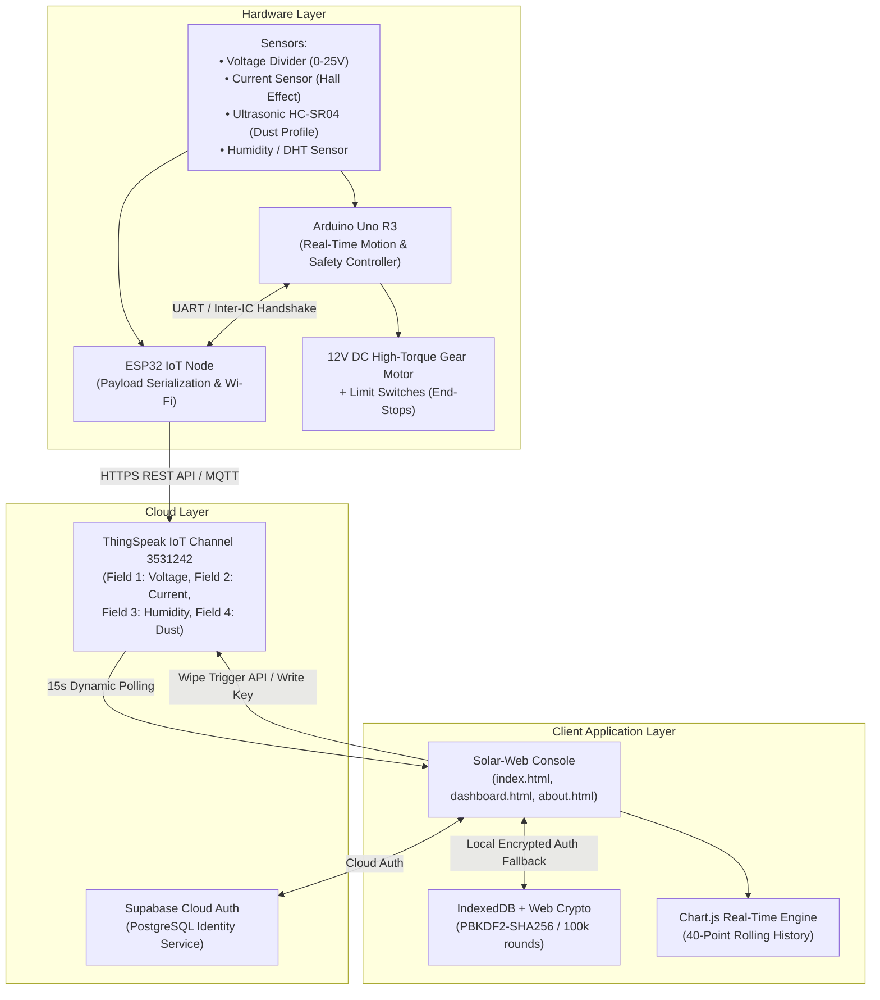

# Solar-Web | Circuitech ☀️🤖
### Autonomous Photovoltaic Cleaning & Real-Time IoT Telemetry Platform

[](https://github.com/KeshavBuilds08/Solar-Web)
[](https://thingspeak.mathworks.com/channels/3531242)
[](https://www.arduino.cc/)
[](https://supabase.com)
[](https://www.chartjs.org/)
[](LICENSE)

---

## 📌 Executive Overview

**Circuitech (Solar-Web)** is an industrial-grade, closed-loop autonomous solar panel cleaning and predictive monitoring platform. Solar photovoltaic (PV) installations suffer from **photovoltaic soiling**—the continuous accumulation of airborne dust, particulate matter, industrial soot, and pollen on the panel surface—which can degrade overall conversion efficiency by **15% to 35%**, particularly in arid, semi-arid, and urban environments.

Traditional maintenance regimes rely on manual scheduling, visual inspection, and intensive water consumption. **Solar-Web** solves this through a distributed **dual-microcontroller hardware architecture** coupled with a high-fidelity **cloud telemetry console**:
- **Continuous Condition Monitoring:** Streams voltage, current, relative humidity, and acoustic soiling metrics to the cloud every 15 seconds.
- **Closed-Loop Automated Cleaning:** Detects soiling thresholds and actuates a motorized wiping gantry only when yield losses exceed limits and weather conditions are safe (avoiding mud formation during precipitation/heavy dew).
- **Dual-Tier Security Engine:** Combines Supabase Cloud PostgreSQL authentication with an air-gapped local IndexedDB fallback hardened with Web Crypto PBKDF2-SHA256 (100,000 iterations).

---

## 🏗️ System Architecture & Data Flow



---

## ⚙️ Key Technical Features

### 1. Dual-Microcontroller Distributed Topology
- **ESP32 IoT Gateway:** Manages 802.11 b/g/n Wi-Fi connectivity, JSON payload serialization, and bidirectional HTTPS REST API communication with the ThingSpeak Cloud infrastructure.
- **Arduino Uno R3 Real-Time Co-Processor:** Dedicated deterministic motion controller executing PWM motor actuation, reading safety limit switches, handling end-stop interrupts, and preventing stalls.

### 2. Multi-Spectral Telemetry & Calculated Metrics
The platform synchronizes with **ThingSpeak IoT Channel `3531242`** and ingests telemetry across four dedicated channels:

| Field | Parameter | Unit | Hardware Transducer | Purpose |
|:---:|:---|:---:|:---|:---|
| **Field 1** | Panel DC Voltage | `V` | Resistive divider module (0–25V DC) | Solar array potential & irradiance tracking |
| **Field 2** | Panel Load Current | `mA / A` | Hall-effect current module | Inverter / battery charging load monitoring |
| **Field 3** | Ambient Relative Humidity | `%` | Capacitive digital humidity transducer | Atmospheric lockout safeguard against mudding |
| **Field 4** | Ultrasonic Distance | `cm` | HC-SR04 Acoustic Sonar Transducer | Optical clearance & surface dust layer profiling |

#### Dynamically Computed Metrics:
- **Instantaneous Power Output ($P$):** Calculated in real-time as $P = V \times I$ (Watts).
- **Cumulative Energy Yield ($E$):** Riemann numerical trapezoidal integration over operating duration (Watt-hours).
- **Panel Health & Soiling Index:** Derived ratio between baseline irradiance and instantaneous voltage degradation.
- **Actuation Cycles Counter:** Tracks mechanical runtime, motor maintenance schedules, and cleaning frequency.

### 3. Closed-Loop Intelligent Actuation Logic
The autonomous cleaning algorithm initiates motor cycles based on environmental validation:
```
IF (Dust_Distance <= Configured_Threshold_cm) 
   AND (Relative_Humidity <= Configured_Max_Humidity_%) 
   AND (Motor_Status == "idle")
THEN:
   Execute Motorized Sweep Sequence (Forward -> Limit Switch -> Reverse -> Home)
   Increment Cleaning Cycle Counter
   Emit Event Log to Telemetry Console
ELSE:
   Maintain Idle Standby & Log Atmospheric Lockout
```

### 4. Enterprise Dual-Tier Authentication & Security Engine
Designed to operate both connected to global cloud infrastructure and in offline/air-gapped solar farm microgrids:
1. **Cloud Tier (Supabase):**
   - Connects to Supabase Cloud PostgreSQL backend.
   - Enables centralized credentials and multi-device cross-browser administrative sessions.
2. **Local Fallback Tier (Client-Side Hardened):**
   - IndexedDB structured object store (`CircuitechSecureStore`).
   - Web Cryptography API implementation using **PBKDF2 with SHA-256**, random 16-byte cryptographic salt generation, and **100,000 hash iterations**.
   - Brute-force protection: Locks account for 5 minutes after 5 consecutive failed login attempts.
   - Ephemeral session tokens valid for 8 hours with instant cryptographic session verification before loading the console.

### 5. High-Aesthetic Interactive UI
- **Design System:** Sleek, modern dark-mode aesthetic with CSS glassmorphism, HSL color tokens, micro-interactions, responsive CSS grid/flexbox layouts, and custom SVG iconography.
- **Live Visualizations:** Powered by Chart.js 4.4+ featuring multi-axis rolling time-series charts for Voltage, Current, Humidity, and Soiling Distance.
- **Real-time Diagnostic Log:** Color-coded event log (Info, Warning, Actuation, Alert) updating dynamically upon each cloud sync.

---

## 📂 Project Directory Structure

```plaintext
Circuitech/
├── index.html          # Public Landing Page & System Capabilities Overview
├── about.html          # Engineering Whitepaper & Technical Architecture
├── dashboard.html      # Protected Real-Time Telemetry Console & Motor Controls
├── login.html          # Secure Access Portal (Cloud Supabase + Local Fallback)
├── register.html       # Operator Account Creation & Cryptographic Provisioning
├── README.md           # Project Documentation & Technical Review
├── css/
│   ├── main.css        # Core Design Tokens, Typography, Layout & Animations
│   ├── style.css       # Dashboard Styling, Charts, Gauges & Telemetry Panels
│   └── auth.css        # Glassmorphic Authentication Card & Input Controls
└── js/
    ├── app.js          # ThingSpeak IoT Engine, Chart.js Controller & State Machine
    ├── auth.js         # Authentication UI Controller & Session Lifecycle Handler
    └── db.js           # Universal Security Engine (Supabase + PBKDF2 IndexedDB)
```

---

## 🚀 Quick Start & Installation

### Option 1: Direct Browser Launch
Because the web platform is built with modern vanilla web standards (HTML5, CSS3, ES6 JavaScript, and Web Cryptography API), no complex build toolchain or NodeJS server is strictly mandatory.

1. Clone or download this repository:
   ```bash
   git clone https://github.com/KeshavBuilds08/Solar-Web.git
   cd Solar-Web
   ```
2. Open `index.html` in any modern web browser (Google Chrome, Microsoft Edge, Firefox, or Safari).

### Option 2: Local HTTP Server (Recommended)
To prevent browser CORS or storage restrictions when accessing local files:
```bash
# Using Python 3:
python -m http.server 8000

# Using Node.js (npx):
npx serve .
```
Navigate to `http://localhost:8000` in your browser.

---

## 🔧 Cloud Configuration & Customization

### ThingSpeak IoT Settings
Default credentials in [`js/app.js`](js/app.js):
- **Channel ID:** `3531242`
- **Read API Key:** `VSKXXRE6IET6WPZJ`
- **Write API Key:** `5KRH68GL6XUO6C9`
- **Poll Interval:** `15000 ms` (15 seconds, optimal for ThingSpeak rate limits)

*You can customize your own Channel ID and Keys directly inside the Telemetry Console modal or by modifying `CONFIG` in `js/app.js`.*

### Supabase Cloud Database Settings
To sync authentication across devices in [`js/db.js`](js/db.js):
- **Project URL:** `https://akdbhjonjholgpxqhfkc.supabase.co`
- **Publishable Anon Key:** Configured in `CLOUD_CONFIG` or customizable via the in-browser authentication modal.

---

## 🛠️ Hardware Bill of Materials (BOM)

| Component | Quantity | Specification / Description |
|:---|:---:|:---|
| **ESP32 DevKit V1** | 1 | Dual-core Tensilica Xtensa 32-bit LX6, 2.4 GHz Wi-Fi |
| **Arduino Uno R3** | 1 | ATmega328P microcontroller for real-time motor actuation |
| **DC Gear Motor** | 1 | 12V High-Torque metal gear motor with linear carriage rail |
| **L298N / Relay Module** | 1 | Dual H-bridge bidirectional motor driver |
| **HC-SR04 Ultrasonic Sensor** | 1 | 40 kHz acoustic sonar distance transducer |
| **Voltage Sensor Module** | 1 | 0–25V DC resistive divider |
| **ACS712 / Hall Sensor** | 1 | Analog linear current sensor module |
| **DHT11 / DHT22 Sensor** | 1 | Digital temperature and relative humidity sensor |
| **Micro Limit Switches** | 2 | Mechanical roller-lever end-stop sensors |
| **Solar PV Panel** | 1 | Polycrystalline/Monocrystalline testing module (12V–18V) |

---

## 🔬 Mathematical Formulations

1. **Instantaneous Electric Power:**
   $$P(t) = V(t) \times I(t)$$
   Where $V(t)$ is instantaneous panel voltage in Volts and $I(t)$ is instantaneous current in Amperes.

2. **Accumulated Energy Yield:**
   $$E = \int_{0}^{T} P(t) \, dt \approx \sum_{k=1}^{N} \frac{P(t_k) + P(t_{k-1})}{2} \cdot \Delta t$$

3. **Dust Soiling Attenuation Index ($S_i$):**
   $$S_i = \left( 1 - \frac{V_{\text{actual}}}{V_{\text{expected}}(\text{Irradiance})} \right) \times 100\%$$

---

## 👥 Contributors

- **Keshav** ([@KeshavBuilds08](https://github.com/KeshavBuilds08)) — *Hardware Architecture, IoT Cloud Integration & Web Application Development*

---

## 📄 License

This project is licensed under the **MIT License** — feel free to use, modify, and distribute for academic, personal, and industrial solar automation projects.
